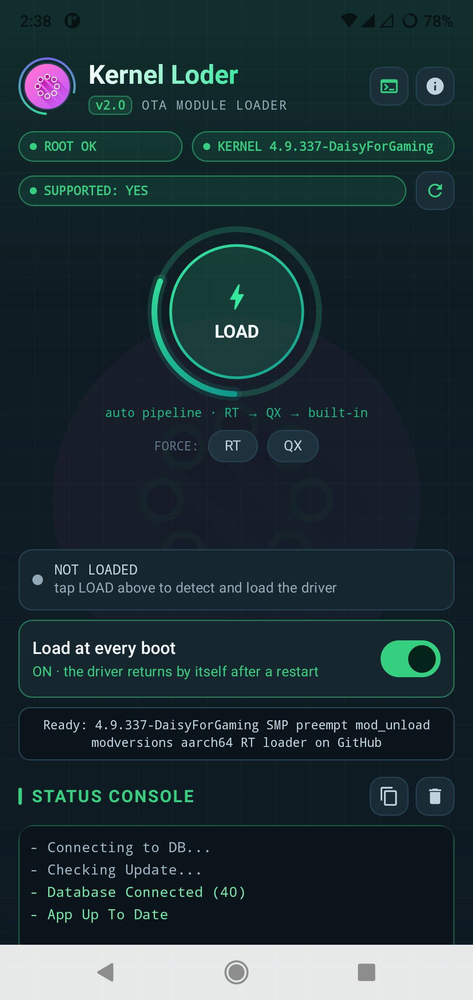
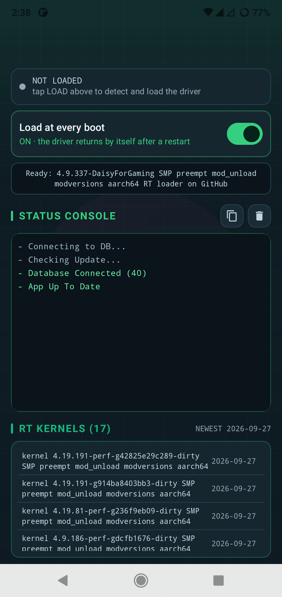

<div align="center">


# Kernel Loader

### Automated Kernel Module Loader and Diagnostic Suite for Android
**Detects running kernel · Downloads matching module · In-app verification**

[](../../releases/latest)
[](#requirements)
[](#requirements)
[](LICENSE)

</div>

---

**Kernel Loader** is a root-powered Android application designed to resolve, download, insert, and verify kernel modules (`.ko`) across Linux kernels 4.9 through 6.12. It matches the exact running kernel against a live OTA driver catalog, verifies real-time physical memory read/write access via an integrated verification binary (`Driver.sh`), and packages complete hardware diagnostic dumps for custom driver compilation.

---

## Key Features

- **Unified Load Pipeline**: Automatically matches the exact kernel version, downloads the compatible driver from the live OTA repository, and loads it into kernel space.
- **In-App R/W Verification**: Direct execution of the `Driver.sh` memory engine within the terminal screen to verify physical memory read and write operations.
- **Detailed Error Reporting**: When a module load fails, the loader extracts and displays the root cause directly from kernel ring buffers (`dmesg`), avoiding generic verification errors.
- **Diagnostic Report Pack**: Generates a self-contained ZIP archive containing:
  - Exact `boot.img` partition dump (detected via active A/B slot and block device mapping).
  - Full kernel symbol table (`/proc/kallsyms`).
  - Sample OEM vendor module (`.ko`) with extracted compiler vermagic and configuration.
  - Decompressed kernel configuration (`/proc/config.gz` or `/proc/config`).
  - Kernel ring buffer logs (`dmesg`) and live application logs.
- **One-Tap Sharing**: Direct integration with WhatsApp and Telegram with full FileProvider permission handling and clip-data propagation.
- **Security and Hardening**:
  - Full-mode R8 code shrinking and class obfuscation.
  - Runtime anti-tamper shield detecting Frida, debuggers, ptrace, and Xposed hooks.
  - Network security configuration enforcing direct connections (`NO_PROXY`).

---

## Screenshots

| Home | Live Terminal |
|---|---|
|  |  |

---

## Requirements

| Component | Requirement |
|---|---|
| Root Provider | Magisk, KernelSU, or APatch (Superuser access required) |
| Architecture | ARM64 (aarch64) |
| Android Version | Android 9.0 (API level 28) or higher |
| Connectivity | Internet connection for OTA driver catalog and updates |

---

## Execution Workflow

```text
Tap LOAD
   │
   ├─► Pre-flight validation (Root check, Kernel release, Architecture)
   │
   ├─► OTA catalog resolution (Exact kernel match from repository)
   │
   ├─► Download and integrity verification
   │
   ├─► Staged insmod execution via root shell
   │
   └─► Device node verification and live dmesg validation
```

---

## Diagnostic Report Structure

When building custom drivers for unsupported kernels, the generated ZIP archive includes:

```text
report_<device>_<kernel>.zip
├─ boot.img                  Raw boot partition dump (kernel + ramdisk + dtb)
├─ boot_info.txt             Block device path, header version, and sizes
├─ kallsyms.txt              Kernel symbol addresses (/proc/kallsyms)
├─ sample_vendor_module.ko   Real OEM module from /vendor/lib/modules
├─ vendor_modinfo.txt        Compiler version, vermagic, and module info
├─ config.txt                Kernel configuration options (IKCONFIG)
├─ dmesg.txt                 Kernel ring buffer tail and insmod error details
├─ applog.txt                Application execution console log
├─ proc_cmdline.txt          Kernel boot arguments
├─ proc_version.txt          Kernel compiler and toolchain identification
├─ proc_cpuinfo.txt          CPU hardware specifications
├─ device_props.txt          Android system properties dump
└─ manifest.txt              Summary manifest of all collected artifacts
```

---

## Building from Source

```bash
git clone https://github.com/bmjubairdadu/kernel-loader.git
cd kernel-loader
./gradlew assembleRelease
```

The release APK will be generated at:
`app/build/outputs/apk/release/Kernel-Loader-v2.1.apk`

- Language: Kotlin
- UI Framework: Jetpack Compose
- Root Management: libsu
- Target SDK: 34 (Android 14)
- Minimum SDK: 28 (Android 9)

---

## Security Model

| Security Layer | Implementation |
|---|---|
| Code Obfuscation | R8 full-mode enabled with aggressive name mangling |
| Debugger Protection | Checks `TracerPid` in `/proc/self/status` and `android.os.Debug` |
| Instrumentation Guard | Inspects loaded memory maps for Frida (`frida-agent.so`, `/data/local/tmp/re.frida.server`) |
| Network Integrity | Cleartext traffic disabled; network requests bypass proxy configurations |
| Storage Isolation | Diagnostic staging files isolated in application cache with restricted permissions |

---

## Disclaimer

Loading custom kernel modules requires root access and carries inherent risks including device reboots or bootloops if an incompatible module is loaded. While Kernel Loader conducts pre-load validations, users are advised to maintain backups of their boot images.

---

## License

Author: [JUBAIR HOSEN](https://github.com/bmjubairdadu)  
Licensed under the [GNU General Public License v3.0](LICENSE).
